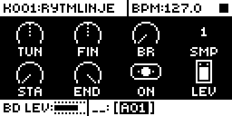
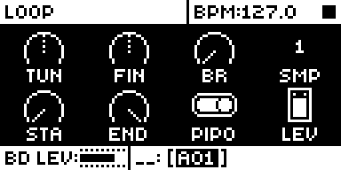
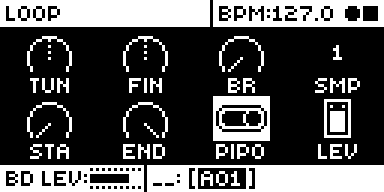
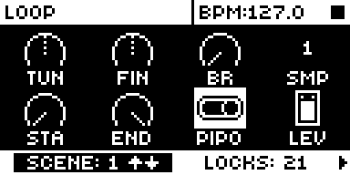

# Pipo Loop

An Analog Rytm MKII mod by npp1993 (Nathaniel Pavel). Version 0.1.0-experimental, OS 1.74 with core-ar2 0.3.

## Overview

Pipo Loop gives the SAMPLE page's LOP parameter a third value, PIPO, after OFF and ON. A sample whose LOP is PIPO plays its loop forward from STA to END, then backward to STA, then forward again, for as long as the note lasts: a ping-pong loop. ON stays the stock forward loop, which jumps back to STA at END, and OFF plays the sample once.

PIPO is an ordinary LOP value. It saves with the sound and the kit, takes parameter locks and scene locks, and comes back after a power cycle. A sound saved with PIPO plays as a normal forward loop on stock OS 1.74 or a build without this mod, because stock reads any nonzero LOP as ON.

On the SAMPLE page, FUNC + turn on STA or END moves that point to the next zero crossing of the sample in the direction you turn, one crossing a detent, so start and loop points sit where the waveform crosses zero. Plain turns stay stock.

The turns are smooth (no jump in the waveform). Each turn falls on the audio engine's 32-frame block, so it comes up to about one block, plus 8 frames, before STA or END.

  

## Controls

| Control | Where | Values |
| --- | --- | --- |
| LOP | SAMPLE page, encoder G | OFF, ON, PIPO, on a three-position switch. OFF and ON play as stock. PIPO plays the loop between STA and END forward, then backward. |
| FUNC + STA / END | SAMPLE page or its SMPL WAVEFORM view, FUNC held, encoder E or F | Each detent moves the point to the next zero crossing the way you turn, never past the other point. With a trig held in GRID RECORDING it steps that trig's lock (the first detent makes the lock, as stock). Plain turns are stock. |

LOP's switch is drawn as stock's three-position switch, the one BD CLASSIC's WAV uses: OFF on the left, ON in the middle, PIPO on the right. PIPO applies only to the sample layer of a sound, as LOP does.

## Usage

Use a build containing Pipo Loop, select a track whose sound plays a sample, and press SAMPLE. LOP is encoder G.

### Quick tutorial

1. On the SAMPLE page, turn LOP past ON to PIPO and play the sound: the loop between STA and END goes back and forth.
2. Set STA and END around a sustained part of the sample (a pad, a vowel, a held note) for a seamless back-and-forth drone.
3. Hold a trig in GRID RECORDING and turn LOP to PIPO to ping-pong only on that step; the other steps keep the sound's ON or OFF.
4. Hold FUNC and turn STA (or END) a detent at a time: the point moves to the next zero crossing each time, so the loop starts and ends where the waveform crosses zero.

### Changes to stock flows

- **LOP has a third value.** What changes: turning LOP clockwise past ON now reaches PIPO; locks and scenes can hold PIPO. Why: a musician looks for loop behaviour on LOP, and a third value needs no new page, key gesture or menu row (a FUNC gesture on the SAMPLE page was considered, but FUNC + STA, END and LOP are stock's coarse steps and FUNC + TUN and FIN belong to Loop Sync). What you see: the value text reads PIPO, and LOP's switch has three positions like BD CLASSIC's WAV, so ON now shows the knob in the middle (stock: on the right). It applies only in a build with this mod; leave LOP on OFF or ON for stock behaviour. Checked beside it: OFF and ON play exactly as stock, LOP's p-locks and scene locks, kit save through power-off, MIDI CC 30.
- **FUNC + turn on STA and END.** What changes: stock steps STA and END by whole numbers with FUNC held; with this mod each FUNC detent moves the point to the next zero crossing of the sample instead. Why: a musician sets start and loop points where they would click least, on the SAMPLE page's own knobs, the way the Octatrack's audio editor steps through crossings; a new page or gesture was not needed. What you see: the point jumps crossing by crossing, on the sound or, with a trig held, on that trig's lock; plain turns are unchanged. It applies only in a build with this mod. Checked beside it: plain turns, lock editing in GRID and LIVE RECORDING, FUNC + TUN and FIN (Loop Sync's), LOP, Silent Pad+Trig's pads and TRIG keys. This moves a stock gesture, so it needs the owner's agreement.
- **MIDI CC 30 (LOP).** Stock writes CC 30's value into LOP unchanged (0 is OFF, anything else ON). With this mod a CC value of exactly 2 gives PIPO; every other value does what it did, and other OFF/ON parameters are unchanged.

## Compatibility and limitations

- OS 1.74 only, with core-ar2 0.3. No other module is needed, and it builds beside Silent Pad+Trig, Filter Hz and Loop Sync (no shared sites).
- Sites: the audio interrupt's call to the voice 0 sample prefetch at 0x40121134 (a `jsr`, through a gate that tail-calls stock), the shared OFF/ON value-text routine at 0x400fb56c (prints PIPO for 2 on LOP's own record, stock text otherwise, so another OFF/ON parameter set to 2 over MIDI still reads ON), LOP's maximum in stock's parameter table at 0x401c04f8 (data, 1.0 to 2.0), and the shared OFF/ON switch icon at 0x400fedf4 (for LOP's record only it tail-calls the three-position switch routine BD CLASSIC's WAV uses, with stock's own frames; every other switch stays stock). Zero snap takes the encoder handler's apply-delta call at 0x4003a240 and its lock call at 0x4003a19c, and stock's per-trig lock edit at 0x40037f6c (STA and END with FUNC held only; every other turn passes through). Loop Sync's audio hook at 0x40121020 runs earlier in the same interrupt; Pipo Loop swaps STA and END after it, and Loop Sync's FUNC + TUN and FIN are not touched.
- A PIPO loop is a few frames shorter at each end than ON's (the turn comes up to one block early). Inaudible on most material, audible on very short loops.
- Stock plays a loop of at least 141 frames; Pipo Loop leaves loops shorter than 160 frames to stock's forward loop.
- A new trig always starts forward from STA, as stock does.
- Zero snap is exact for samples up to 30,720 frames (0.64 s at 48 kHz). STA and END are steps of 1/30,720 of the sample, so on a longer sample the point lands on the nearest step, at most frames / 61,440 frames from the crossing: 1 frame at 1 s, about 4 at 5 s, 8 at 10 s, 47 at 60 s.
- Silence and near-zero DC (within 8 of zero, about -72 dB) count as neither sign: a snap passes over them and lands at their edge. The search reaches about 5.5 s of sample a detent; with nothing found, the turn stays stock's whole-number step.
- On stock OS, PIPO plays as ON. Sounds and kits keep the value, so loading them again with the mod brings PIPO back.
- Not yet run on a unit.

## Tests and measurements

rytm-emu (c5732f0) on OS 1.74, build PP07, with a generated ramp sample on BD: the value steps OFF/ON/PIPO and reads PIPO; ON plays stock's forward loop and PIPO a click-free triangle from TUN -24 to +24; switching ON to PIPO mid-note; FUNC + STA and END stepping crossing by crossing on a test sine with silence and DC in it; p-locks and scene locks of PIPO; two voices at once; retrig; persistence through power-off; and stock 1.74 loading the saved PIPO state as a normal loop. CPU is a static estimate: about 0.1 % of an audio block with nothing looping and about 0.6 % with all eight voices in PIPO. See [TESTING.md](TESTING.md).

## Authorship and licences

Original code by npp1993 (Nathaniel Pavel), GPL-3.0-or-later ([LICENSE](LICENSE)). The OS 1.74 addresses were read by the author from his own stock firmware; the build carries addresses, lengths and SHA-256 guards only, no stock bytes. Screenshots: [media/LICENSE.md](media/LICENSE.md).

## Screens and audio

Screenshots are rytm-emu captures of build PP06 ([media/capture.json](media/capture.json)). No audio preview yet.
